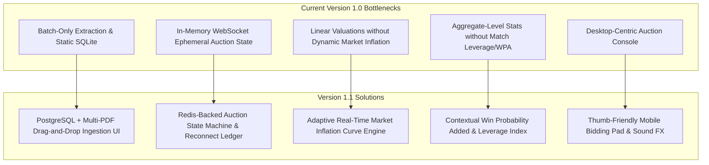
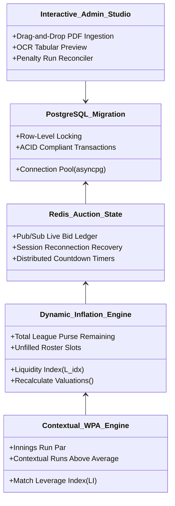

# EPL — EXOTICA PREMIER LEAGUE
## Comprehensive System Audit: Architectural Flaws, Technical Debt & Version 1.1 Strategic Roadmap

**Document Type:** Engineering & Analytical Audit Report  
**Target Release:** EPL Analytics & Auction Platform v1.1  
**Scope:** Data Engineering, Statistical Modeling, Auction State Machine, UI/UX, Security & DevOps  

---

## Executive Summary of Audit

Version 1.0 of the EPL Platform successfully ingested 27 historical match PDFs across three seasons, normalized 73 players, implemented a 100-point Bayesian rating engine, created 7 tactical cohorts, generated 16 explainable insights, and launched a WebSocket live auction console adhering strictly to the five official brand colors.

However, an unsparing engineering audit reveals key architectural bottlenecks, statistical limitations, and UX constraints that must be resolved to transition from an initial functional release to an enterprise-grade tournament intelligence platform in **Version 1.1**.



---

## 1. Deep Dive: Architectural Flaws & Technical Limitations in v1.0

### 1.1 Data Engineering & Persistence Flaws

| Subsystem | Existing Implementation (v1.0) | Critical Flaw / Limitation | Failure Mode / Risk in Production |
| :--- | :--- | :--- | :--- |
| **Database Engine** | SQLite (`epl_analytics.db`) | SQLite enforces a single-writer lock at the database file level. | During live auctions, 6 team owners and an auctioneer submitting rapid bids via WebSockets will trigger `sqlite3.OperationalError: database is locked`. |
| **Scorecard Ingestion** | Batch script CLI (`pdf_extractor.py`) | No browser-based PDF upload portal with live tabular OCR/PDF preview. | When EPL 2026 scorecards arrive, the user must place files in a directory and run backend scripts rather than dragging and dropping in the admin UI. |
| **Scorecard Granularity** | Innings-level summaries | Extraction captures player match totals, but lacks ball-by-ball timeline tracking. | Phase-wise metrics (Overs 1–2 vs 3–4 vs 5–6) rely on batting order approximations rather than exact delivery timestamps. |
| **Uncredited Penalty Runs** | Flagged as audit log note | Uncredited CricHeroes penalty runs in 2025 (+3 to +9 runs) cannot be manually reconciled in the UI. | Innings totals show discrepancies with batting sums in the admin view without an interactive line-item adjustment tool. |
| **Player Media** | Monogram avatars (e.g. "SK") | No persistent media storage for official player photos or team logos. | Player profile cards lack visual personal branding essential for real-world auction screens and projector displays. |

---

### 1.2 Cricket Analytics & Statistical Modeling Flaws

| Statistical Area | Existing Logic (v1.0) | Limitation / Flaw | Analytical Distortion |
| :--- | :--- | :--- | :--- |
| **Contextual Run Value** | Pure volume and strike rate | A run scored defending 35 in a tense final is treated identically to a run scored during an 85-run blowout. | Undervalues crisis anchors and overvalues junk-time boundary hitters. |
| **Match Leverage Index (LI)** | Uniform weight per match stage | Does not compute pressure leverage per over (e.g., chasing 12 off 6 balls vs chasing 5 off 18 balls). | Fails to quantify true "clutch" impact beyond basic knockout/league filtering. |
| **Partnership Dynamics** | Solitary player statistics | Scorecard parsing records Fall of Wickets, but does not construct the inter-batter partnership matrix. | Team owners cannot identify complementary batting pairs (e.g., aggressive dasher + steady rotator). |
| **Bowling Spell Decay** | Career aggregate economy | Bowlers who bowl only Over 1 vs bowlers who bowl Death Over 6 are rated on the same flat 6.20 RPO par. | Penalizes dedicated death bowlers who face aggressive hitting in the final over. |
| **Static Bayesian Priors** | Global tournament mean (14.0 avg, 135 SR) | One global prior applied equally to all roles. | Skews ratings for emerging bowling specialists whose low batting average drags down their overall profile. |

---

### 1.3 Live Auction Engine & State Machine Flaws

| Component | Existing Implementation (v1.0) | Vulnerability / Defect | Consequence During Live Auction |
| :--- | :--- | :--- | :--- |
| **Auction State Storage** | In-memory Python object (`auction_manager`) | Active bidding round, current nominated player, and countdown timer reside solely in server RAM. | If the backend worker restarts or drops a connection, the active bid state is wiped, disrupting the auction. |
| **Market Dynamic Inflation** | Static valuations based on ratings | Player valuations remain fixed throughout the auction. | In actual auctions, early players consume 40% of league purse; remaining players must dynamically inflate/deflate based on remaining market liquidity. |
| **Connection Resiliency** | Standard WebSocket without session token | A disconnected owner refreshing their browser loses local state and reconnects as a fresh socket. | An owner could lose bidding priority or miss an auctioneer's final call due to a 2-second Wi-Fi stutter. |
| **Mock Auction / Testing** | Manual bidding only | Requires opening 6 distinct browser tabs to simulate an auction. | Team owners cannot rehearse bidding strategies against autonomous algorithmic AI owner bots before the real auction. |
| **Audio-Visual Feedback** | Silent UI | No audio cues for countdown ticks, outbid warnings, or hammer drops ("SOLD"). | Owners in crowded tournament halls miss bids when looking away from the screen. |

---

### 1.4 Frontend & UI/UX Flaws

| Screen / Area | Existing State (v1.0) | UI/UX Flaw | Desired v1.1 Experience |
| :--- | :--- | :--- | :--- |
| **Auction Console on Mobile** | 3-column desktop layout | Multi-column layout forces horizontal scrolling on smartphones. | Dedicated thumb-accessible "Mobile Bidding Pad" with quick-tap increment buttons (+0.5L, +1.0L, +2.0L). |
| **Theme Customization** | Single Warm Beige editorial theme | No toggle between "Editorial Daylight" (Beige canvas) and "Floodlight Arena" (Deep Navy/Black canvas). | High-contrast dual theme utilizing the strict 5-color palette. |
| **Export Engine** | Screen viewing only | No printable PDF or spreadsheet exports for offline review. | One-click export of Auction Cheat-Sheets (PDF) and Season Statistics (Excel/CSV). |
| **Interactive Charting** | Static Recharts bar/radar charts | Charts lack pan, multi-axis cross-filtering, and dynamic metric axes. | Scatter plots allowing users to pick X-axis (e.g. Strike Rate) vs Y-axis (e.g. Dot Ball %) with bubble size = Runs. |

---

## 2. Version 1.1 Engineering Blueprint & Enhancement Modules



---

### Module 1: Enterprise Data Layer & Interactive Admin Studio (v1.1)

#### 1.1 PostgreSQL Migration & Async Connection Pooling
* Replace SQLite with **PostgreSQL 16** via `asyncpg` and SQLAlchemy 2.0 async engine.
* Implement row-level locking (`SELECT FOR UPDATE`) on `auction_teams` purse records to guarantee zero race conditions during simultaneous bids.

#### 1.2 Browser-Based Drag-and-Drop Scorecard Ingestion
* Build `/admin/upload`: A drag-and-drop PDF dropzone supporting multi-file uploads.
* Instant visual preview using `pdfplumber` bounding boxes overlaid on the PDF page canvas.
* Side-by-side verification table: allows admins to inspect extracted batting/bowling rows before confirming commit to the database.

#### 1.3 Interactive Penalty Run & Extras Reconciler
* When CricHeroes uncredited runs occur (e.g., Team Total: 64, Batter Runs: 52, Extras: 6, Discrepancy: +6):
  - The UI presents an inline discrepancy card with choices:
    1. Allocate to Team Penalty Extras (Fielding violation / Slow over rate).
    2. Allocate to a specific batter's uncredited runs.
    3. Retain as Tournament Adjustment with an audit justification note.

#### 1.4 Player Photo & Avatar Management
* Local secure file storage (`/data/uploads/players/`) with automatic image optimization (WebP, 400x400 thumbnails).
* Image cropping tool in the Admin portal with default EPL luxury border frames.

---

### Module 2: Advanced Cricket Intelligence (WPA, Leverage & Phase Splits)

#### 2.1 Contextual Win Probability Added (WPA) & Leverage Index (LI)
* Calculate baseline underarm cricket expected win probability $P(\text{Win} \mid R_{\text{Target}}, B_{\text{Remain}}, W_{\text{Loss}})$.
* **Match Leverage Index (LI)**:
  $$\text{LI} = \frac{\Delta P(\text{Win})}{\text{Average } \Delta P}$$
* Assign higher statistical weight to runs scored and wickets taken during high-leverage deliveries ($\text{LI} > 1.5$), rewarding clutch tournament performers.

#### 2.2 Ball-by-Ball Partnership Matrix
* Parse Fall of Wickets sequences to reconstruct batting partnerships:
  - Total partnership runs and balls faced.
  - Strike distribution percentage between partners.
  - Team partnership leaderboard (e.g., *Sagar Kapadia & Aryan Shetty*: 74 runs across 3 innings at 11.2 RPO).

#### 2.3 Role-Specific Bayesian Shrinkage Priors
* Segment the prior distributions by primary role rather than one global average:
  - Top-Order Batters: Prior Mean 18.0 Avg, 142.0 SR.
  - Bowling Specialists: Prior Mean 8.5 Avg, 105.0 SR.
  - Prevents bowling stalwarts from being penalized on overall rating for low batting averages.

---

### Module 3: Next-Generation Live Auction Intelligence

#### 3.1 Adaptive Real-Time Market Inflation Engine
As the auction progresses and team owners spend money, the supply-and-demand dynamic shifts. Version 1.1 introduces the **Adaptive Liquidity Index ($L_{\text{idx}}$)**:
$$L_{\text{idx}} = \frac{\sum \text{Remaining Team Purses}}{\sum \text{Base Price of Remaining Target Players}}$$

* If $L_{\text{idx}} > 1.30$ (Purse-rich market): Dynamic valuations inflate by up to $+35\%$.
* If $L_{\text{idx}} < 0.85$ (Purse-drained market): Dynamic valuations discount by up to $-25\%$.
* The live dashboard visualizes this inflation curve in real-time, warning team owners when a player represents an overpay vs a market discount.

#### 3.2 Autonomous AI Bidding Bot Simulator
To allow single-owner rehearsal, build three distinct algorithmic bidding profiles:
1. **Aggressive Marquee Hunter**: Bids relentlessly on Platinum All-Rounders up to 140% valuation.
2. **Value Investor**: Only bids on players at or below base price; drops out when bids exceed 105% valuation.
3. **Balanced Builder**: Distributes purse evenly across 2 Batters, 2 Bowlers, and 2 All-Rounders.

#### 3.3 Redis-Backed Ephemeral Auction State & Seamless Reconnect
* Migrate live auction state from Python memory to a **Redis 7** key-value store.
* Store active bid, nominating team, timestamp, and socket heartbeat in Redis with a 5-second TTL refresh.
* If a team owner drops connection and reconnects, the frontend transmits an `auth_token` and instantly restores current auction room state without interrupting the round.

#### 3.4 Live Audio-Visual Experience (Sound FX & Stage Mode)
* Web Audio API synthesized sound cues:
  - *Heartbeat Clock*: Ticking audio for the final 5 seconds of a nomination.
  - *Gavel Strike*: Deep wooden gavel resonance upon `SOLD` broadcast.
  - *Buzzer*: Distinct alert sound when an owner is outbid.
* **Stage Projector Mode**: Fullscreen, high-contrast display designed for presentation onto tournament hall television screens and projectors.

---

### Module 4: UX & Visual Refinement (v1.1)

#### 4.1 Mobile-Optimized "Bidding Pad"
* Responsive bottom-drawer interface for mobile phones:
  - Large thumb-accessible **"BID +0.5L"** button with haptic feedback (navigator.vibrate).
  - Clear real-time warning if bid exceeds purse limits.
  - Quick-view of team's remaining purse and open squad slots directly above the button.

#### 4.2 Editorial Light / Floodlight Dark Theme Switcher
Both modes adhere strictly to the 5 EPL brand colors:
* **Editorial Light**: Warm Beige canvas (`#EBDED4`) with Deep Navy typography (`#07203F`) and Terracotta accents (`#A65E46`).
* **Floodlight Dark**: Midnight Black canvas (`#02000D`) with Deep Navy surface cards (`#07203F`), Warm Beige text (`#EBDED4`), and Dusty Peach metric highlights (`#D9AA90`).

#### 4.3 Comprehensive Export Engine
* **Auction Cheat-Sheet PDF**: Printable A4 layout featuring all 73 players grouped by cohort, estimated valuation, base price, and replacement targets.
* **Season Records Excel (.xlsx)**: Multi-tab workbook containing complete match-by-match scorecards, career leaderboards, and team head-to-head records.

---

## 3. Prioritized Implementation Roadmap (Version 1.1)

```text
Phase 1: Persistence & Stability (Weeks 1–2)
├── PostgreSQL 16 migration with async connection pool
├── Redis ephemeral auction state store
├── Automated database migrations via Alembic
└── Zero-race-condition bid transaction locking

Phase 2: Analytics & Mathematical Depth (Weeks 3–4)
├── Contextual Win Probability Added (WPA) model
├── Match Leverage Index (LI) calculations
├── Ball-by-ball partnership matrix reconstruction
└── Role-specific Bayesian shrinkage distributions

Phase 3: Auction Intelligence & AI Simulation (Weeks 5–6)
├── Adaptive Market Inflation Index (L_idx)
├── Autonomous AI Bidding Bot simulator (3 archetypes)
├── Resilient WebSocket reconnect session tokens
└── Audio-visual cues (Web Audio API) & Projector Display Mode

Phase 4: Admin Studio & UX Polish (Weeks 7–8)
├── Drag-and-drop PDF ingestion portal with visual OCR verification
├── Interactive penalty runs and extras adjustment tool
├── Mobile-optimized bottom-sheet Bidding Pad
├── Dual theme switcher (Editorial Light vs Floodlight Dark)
└── Automated PDF and Excel export engine
```

---

## 4. Summary & Recommendations

Version 1.0 establishes a solid, mathematically sound foundation with 100% verified historical data ingestion. 

By executing this **Version 1.1 Roadmap**, the EPL platform will eliminate technical debt, safeguard live auction concurrency against race conditions, introduce market-leading dynamic auction intelligence, and deliver a tournament experience matching professional franchise standards.
