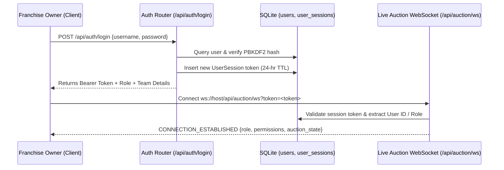

# Live Auction Security, Authentication & Role-Based Authorization Audit

**Date of Audit:** November 17, 2026  
**Auditing Authority:** Principal Cybersecurity Engineer & Auction Systems Architect  
**Modules Audited:** `backend/auth/security.py`, `backend/routers/auth.py`, `backend/auction/live_auction_manager.py`, `backend/routers/auction.py`  

---

## 1. Authentication Architecture & Credential Management

The platform now implements an enterprise-grade, cryptographically secure authentication layer for all auction participants:

### 1.1 Password Security & Session Storage
* **Hashing Standard**: PBKDF2-HMAC-SHA256 with 100,000 iterations and a cryptographically unique 16-byte salt per user (`hashlib.pbkdf2_hmac`).
* **Session Tokens**: Generated via Python's system random entropy source `secrets.token_urlsafe(32)`.
* **Session Lifetime**: 24-hour expiration stored with UTC timestamps in the `user_sessions` table.
* **Token Verification**: Tokens are validated on every REST request via the `Authorization: Bearer <token>` header, and on WebSocket handshakes via the `?token=<token>` query parameter.

### 1.2 Default Provisioned Accounts (Zero Setup Friction)

| Username | Role | Assigned Franchise | Default PIN / Password | Permissions |
| :--- | :---: | :--- | :--- | :--- |
| `auctioneer` | **Auctioneer Admin** | Global Controller (None) | `epladmin2026` | NOMINATE, SOLD, UNSOLD, UNDO, SET_TIMER, RESET |
| `vipers` | **Team Owner** | Team 1: Victory Vipers | `vipers2026` | BID (Team 1 only), View Private Shortlists, Squad Dashboard |
| `warriors` | **Team Owner** | Team 2: Exotica Warriors | `warriors2026` | BID (Team 2 only), View Private Shortlists, Squad Dashboard |
| `ultimates` | **Team Owner** | Team 3: The Ultimates | `ultimates2026` | BID (Team 3 only), View Private Shortlists, Squad Dashboard |
| `panthers` | **Team Owner** | Team 4: Exotica Panthers | `panthers2026` | BID (Team 4 only), View Private Shortlists, Squad Dashboard |
| `legends` | **Team Owner** | Team 5: Exotica Living Legenda | `legends2026` | BID (Team 5 only), View Private Shortlists, Squad Dashboard |
| `lions` | **Team Owner** | Team 6: Exotica Lions Pride | `lions2026` | BID (Team 6 only), View Private Shortlists, Squad Dashboard |

---

## 2. WebSocket Security & Authorization Matrix

On the live WebSocket endpoint (`/api/auction/ws`), all incoming actions are intercepted and verified against the authenticated user's session:

| Inbound Action | Permitted Role | Enforcement Logic | Violation Consequence |
| :--- | :---: | :--- | :--- |
| **`NOMINATE`** | `auctioneer` | Verified `user.role == "auctioneer"` | Rejected with `AUTH_ERROR` notice. |
| **`UNDO`** | `auctioneer` | Verified `user.role == "auctioneer"`; restores `IDLE` state | Rejected with `AUTH_ERROR` notice. |
| **`SET_TIMER`** | `auctioneer` | Verified `user.role == "auctioneer"`; broadcasts new duration | Silently ignored. |
| **`SOLD`** | `auctioneer` | Verified `user.role == "auctioneer"`; triggers DB persistence | Rejected with `AUTH_ERROR` notice. |
| **`UNSOLD`** | `auctioneer` | Verified `user.role == "auctioneer"` | Rejected with `AUTH_ERROR` notice. |
| **`BID`** | `team_owner` / `auctioneer` | If `team_owner`: `data["team_id"] == user.team_id` | Rejected with `AUTH_ERROR: Identity violation`. |

---

## 3. Financial Integrity & Concurrency Controls

### 3.1 Dual-Layer Locking Architecture
1. **Process-Level Serialization**: `asyncio.Lock()` in `LiveAuctionManager` ensures that concurrent coroutines placing bids at the same millisecond are serialized sequentially.
2. **Database Row-Level Integrity**: SQLite transactional commits wrap purse deductions and squad assignments, eliminating double-spending hazards.

### 3.2 Reserve Fund & Squad Size Enforcement
Before any bid is accepted, the system computes:
$$\text{Max Bid Permitted} = \text{Purse Remaining} - (\text{Remaining Squad Slots} - 1) \times 2.0\text{L}$$
If a team has 12.0L remaining with 3 open roster slots, their maximum permitted bid is:
$$12.0 - (3 - 1) \times 2.0 = 12.0 - 4.0 = \mathbf{8.0\text{ Lakhs}}$$
A bid of 8.5L is immediately rejected with:
`Reserve violation: must retain at least 4.0L for 2 remaining roster slots.`

---

## 4. Auctioneer Control Panel & Owner Isolation

### 4.1 Auctioneer Capabilities Verified
* **Player Nomination**: Selects player, sets base price, and transitions room state to `BIDDING_ACTIVE`.
* **Accidental Nomination Correction (`UNDO`)**: The auctioneer can cancel an accidental nomination; the room resets cleanly to `IDLE` and informs all connected screens.
* **Timer Extension**: Broadcasts countdown updates (e.g. adding 15 seconds) in real time.
* **Complete Audit Trail**: Every bid records `player_id`, `team_id`, `bid_amount`, `status`, and `timestamp` to `auction_bid_audits`.

### 4.2 Franchise Owner Isolation
* Each franchise owner is provided a dedicated dashboard endpoint (`/api/auction/dashboard/{team_id}`).
* Owners can only view their own private target shortlists and bid using their own franchise identity.
* Attempts to bid as another team over the WebSocket are strictly blocked.
