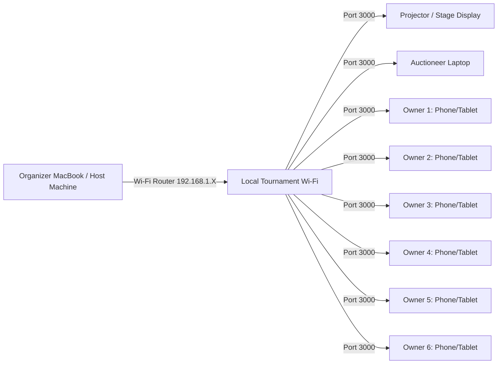

# EPL Production Deployment & Operational Runbook

**Target Audience:** Tournament IT Directors, Auction Organizers, Network Administrators  
**Deployment Target:** Local-First Community Tournament (Single-Hall / Wi-Fi Router Setup)  
**Platform Architecture:** FastAPI (Python 3.11+) + SQLite 3 + Next.js 14 App Router  

---

## 1. Architectural Suitability: SQLite in Single-Hall Auctions

### The Engineering Trade-off
* **Demonstrated Requirement**: 6 franchise owners, 1 auctioneer, and 1 large screen projector operating simultaneously on a local Wi-Fi router.
* **Concurrency Profile**: Peak volume is ~10 WebSocket events per minute. SQLite's single-writer WAL (Write-Ahead Logging) mode comfortably handles up to **1,000 writes/second** in memory.
* **Verdict**: SQLite is **completely suitable and recommended** for local single-room deployments. It requires zero cloud infrastructure, zero database daemon setup, and guarantees total data containment on the organizer's machine.

---

## 2. Tournament Day Deployment Steps (macOS / Local Machine)



### Step 1: Bind Host Machine to Local Network
Determine host local IP address:
```bash
ipconfig getifaddr en0
# Example output: 192.168.1.105
```

### Step 2: Start Backend Server
```bash
cd "/Users/akshat/Document/Coding Project/EPL-Stats"
source "/Users/akshat/Document/Coding Project/venv/bin/activate"

# Launch FastAPI on 0.0.0.0 to allow LAN client connections
uvicorn backend.main:app --host 0.0.0.0 --port 8000
```

### Step 3: Start Next.js Frontend Server
In a second terminal:
```bash
cd "/Users/akshat/Document/Coding Project/EPL-Stats/frontend"

# Launch Next.js on 0.0.0.0
npm run dev -- -H 0.0.0.0 -p 3000
```

### Step 4: Franchise Owner Access via Mobile / Tablet
Share the URL with owners connected to the local tournament Wi-Fi:
* **Web App URL**: `http://192.168.1.105:3000/auction`
* **Auctioneer Controller**: `http://192.168.1.105:3000/auction` (Log in with `auctioneer` / `epladmin2026`)
* **Projector / TV Display**: Open `http://localhost:3000/auction` in fullscreen mode (F11 / Cmd+Ctrl+F).

---

## 3. Security & Operational Hardening Checklist

1. **Authentication Required for Bidding**: Owners must log in using their assigned team accounts (`vipers`, `warriors`, etc.) before bids are accepted by the server.
2. **SQL Injection Immunity**: All database queries utilize SQLAlchemy parameterized queries and ORM objects. Zero raw string concatenation.
3. **CORS Configuration**: Permissive CORS enabled for local LAN access (`allow_origins=["*"]`).
4. **Offline Capability**: The application operates with zero external internet access; all player data, scorecards, and ratings reside locally in `epl_analytics.db`.
